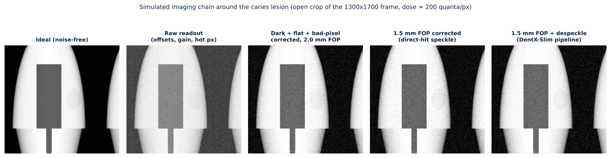
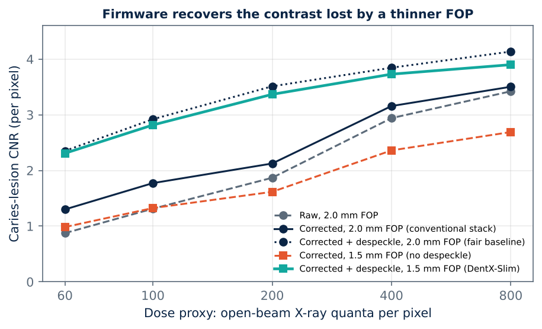
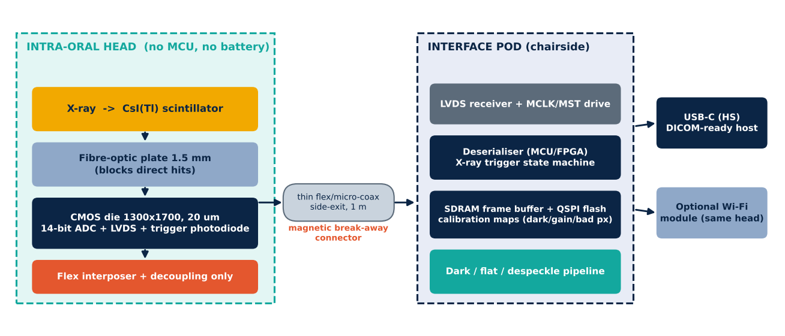
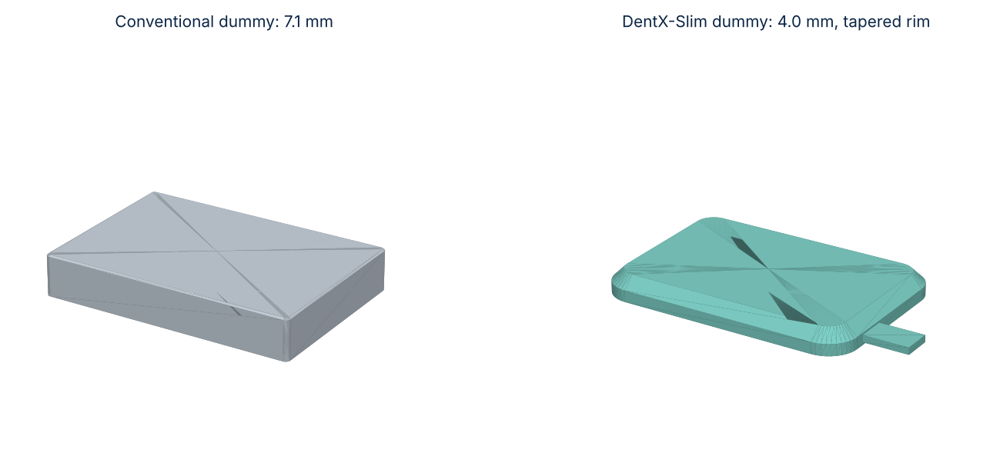

# DentX-Slim: simulation proof of concept

Simulation of a low-profile intra-oral X-ray sensor imaging chain and the chairside pod firmware pipeline.
Part of the DentX Dental X-Ray Sensor Hackathon submission by [Sai Venkata Ajay Uppalapati](https://github.com/uppalapati-Ajay) ([LinkedIn](https://www.linkedin.com/in/ajay-uppalapati-06865124b)).

No X-ray radiation is used. All noise and material parameters are illustrative; anchors from published sources are listed in the proposal appendix.

## Run
```bash
pip install numpy scipy matplotlib
python3 dentx_sensor_sim.py
```
Fixed seed (7). Prints contrast-to-noise and PSNR tables and writes all figures to `figures/`.

## Also in this repository
- `cad/generate_cad.py`: generates `dentx_slim_dummy.stl` (4.0 mm, tapered rim) and `conventional_dummy.stl` (7.1 mm) for 3D printing comfort dummies; checks the meshes are watertight.
- Interactive browser simulator: [live demo](https://claude.ai/artifact/7agxpv4szDpcF9JYzHSyoJ) (standalone file `dentx_interactive_demo.html` in the submission folder).

## What it shows
| Case (dose 200 quanta/px) | Raw CNR | Corrected | Corrected + despeckle |
|---|---|---|---|
| 2.0 mm FOP (conventional) | 1.95 | 2.23 | 3.63 |
| 1.5 mm FOP (DentX-Slim) | 1.38 | 1.47 | 3.44 |

A thinner fibre-optic plate lets more direct-hit speckle through; the pod pipeline (dark, flat-field, bad-pixel repair, despeckle) recovers about 95% of the conventional stack's contrast.





